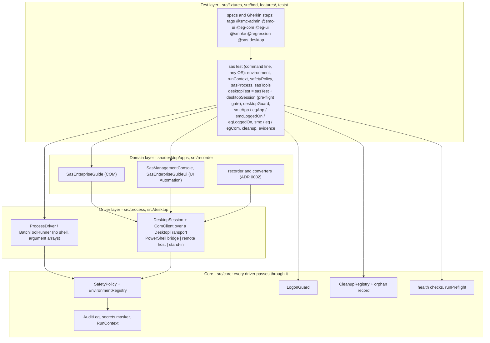

# Architecture

The picture is [ADR 0001](adr/0001-sas-automation-architecture.md) (and [ADR 0002](adr/0002-record-and-play-for-sas-desktop-apps.md) for record and play); this page says where each part lives. **SAS Viya is out of scope**: the family's `api` and `ui` packages cover it.

> **NOT VERIFIED.** Nothing here has run on a real Windows desktop with the real SAS programs. Everything is developed against stand-ins; see [`DESKTOP_SAS.md`](DESKTOP_SAS.md) for exactly what is assumed.

## The layers and the folders

| ADR 0001 decision | Where |
|---|---|
| Playwright Test the only runner, TypeScript the only language | `playwright.config.ts`; `src/fixtures` extends Playwright's `test` through the `ui` package's |
| Four mechanisms, each an `Adapter` (health, typed errors, logging, timeouts) | HTTPS: not used here (Viya is out of scope). Child process: `src/process`. PowerShell bridge speaking JSON lines: `src/desktop` + `bridge/sas-desktop-bridge.ps1`. Browser: not used here |
| API first, GUI last | The order of preference in the [README](../README.md#the-order-of-preference): command line, COM, screens |
| A policy gate in front of every privileged action | `src/core/safetyPolicy.ts`; plugged into the desktop layer by `src/fixtures/guardAdapter.ts` |
| Capability-based design: a missing capability skips with a reason | Tags; the `desktopGate` fixture of `desktopTest` (`src/fixtures/index.ts`; `sasTest` has none, so the command line runs on every system); the opt-in of `tests/real` (`tests/support/realOptIn.ts`); `scripts/min-executed.js` counts the skips |
| `SasCodeRunner` | Not built yet (ADR build order step 4; waits for the installation inventory) |

| ADR 0001 property | Where |
|---|---|
| Credentials never printed, a pair from one source | `src/core/credentials.ts`, `src/core/secrets.ts`; `src/fixtures/credentials.ts` |
| Lockout protection | `src/core/logonGuard.ts`; used by `src/fixtures/logon.ts` for every logon |
| Environment allow-list and safety policy | `src/core/environments.ts`, `src/core/safetyPolicy.ts`; `env/sas-environments.json` |
| Process hygiene | `src/process/processDriver.ts` |
| Bridge script verified against a pinned SHA-256 | `bridge/generate-hash.js`, `src/desktop/bridgeFile.ts`; checked once per worker before a transport opens by `src/fixtures/bridge.ts` |
| Evidence hygiene | `src/core/runContext.ts` (the run's folder, retention); `src/fixtures/evidence.ts` |
| Audit | `src/core/audit.ts` (one JSON line per privileged action) |
| Pre-flight health gate | `src/core/health.ts`; `src/fixtures/preflight.ts` (once per worker) |
| Isolation and clean-up | `src/core/cleanup.ts`; `src/fixtures/cleanup.ts` (after the test, pass or fail) |
| One desktop = one worker | `src/fixtures/parallelism.ts`; `playwright.config.ts`; the `desktopHost` fixture |
| Honest verification | Stand-ins (`src/desktop/fakeDesktop.ts`, `fakeApps.ts`, `standInBridge.ts`); NOT VERIFIED labels; `tests/real/` for a real machine |

## How a test reaches SAS

1. `playwright.config.ts` calls `initRunContext()`: one run id for every worker (`SAS_RUN_ID`), and the run's namespace `AUTO_<runId>`.
2. A worker resolves its settings once (`src/fixtures/settings.ts`): a misspelt value stops the worker with one message naming the setting.
3. `desktopHost` opens the transport (PowerShell, remote or the stand-in) with the **policy adapter** as the desktop layer's `OperationGuard`; `desktopSession` then runs the **pre-flight gate**.
4. A test asks for `smcLoggedOn`: the fixture launches (or attaches to) the program, logs on through `LogonGuard.protect` - a rejection writes the marker and is never retried - and hands it over. Every step of the program's wrapper asks the guard first: high-level operations (`logon`, `runProject`) are judged once, raw UI steps by the environment kind only.
5. After the test the fixtures take evidence (`SAS_EVIDENCE`), run the clean-up (the program is still open), and close the programs they started under `housekeeping` (closing a program is judged as a read, so a read-only run of production can still end cleanly).

## The adapter's rules in one place

[`src/fixtures/guardAdapter.ts`](../src/fixtures/guardAdapter.ts) is where the core's vocabulary (environment, host, namespace) meets the desktop layer's (driver, operation, local). Its header comment is the specification and `tests/fixtures/guardAdapter.spec.ts` the proof. The consequence worth knowing: the desktop programs connect through their own saved profiles, so the framework cannot see which host a step contacts - the environment's host list is **not** enforced for desktop steps; its kind, the namespace rule and the audit log are.
