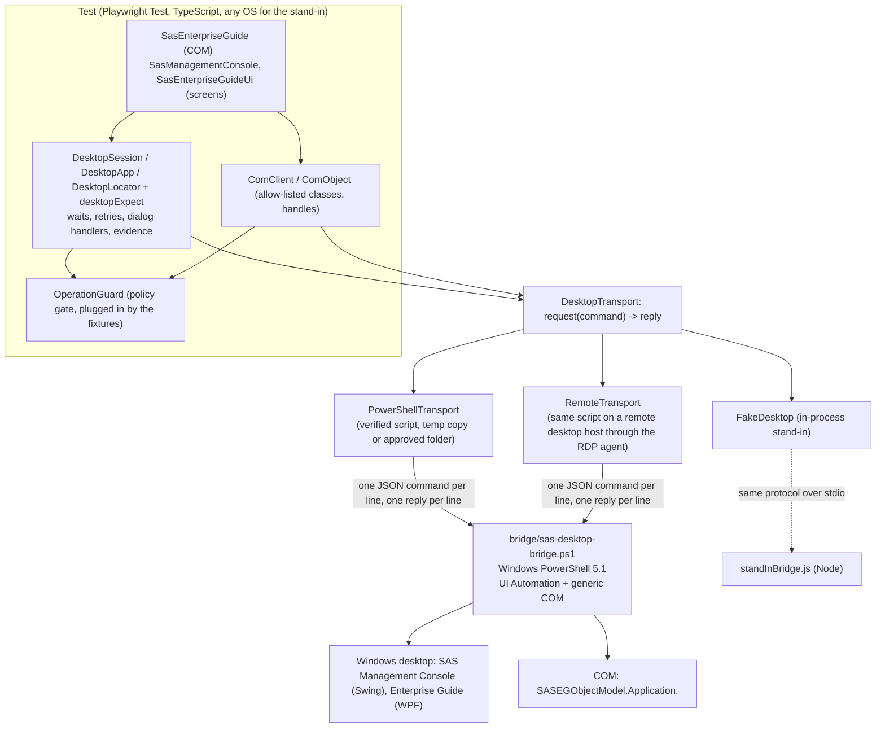

# The Windows desktop layer: Enterprise Guide by COM first, screens last

> **NOT VERIFIED.** The PowerShell bridge (`bridge/sas-desktop-bridge.ps1`) and the two SAS application layers were written on a machine
> with no Windows, no PowerShell and no SAS. Nothing here has run against a real Windows desktop, the real SAS Management Console or
> the real SAS Enterprise Guide. Everything above the transport is tested against an in-memory **stand-in** (a fake desktop with a fake
> Management Console, a fake Enterprise Guide and a fake Enterprise Guide COM object model, also available as a stand-in bridge program
> speaking the real line protocol); the PowerShell file itself is checked only statically (ASCII + byte order mark, balanced braces and
> quotes, the same list of operations and field names as the TypeScript protocol). The first runs on a real desktop are the conformance
> run: start with `sas-desktop-inspect doctor`.

## Order of preference (read this first)

1. **A command line or an API, wherever one exists** (`src/process`: the batch tools and metadata calls; no window involved).
2. **COM, through the bridge**: `SasEnterpriseGuide` opens, runs, exports, saves and quits Enterprise Guide projects through its automation
   object model, and reads every program's log and status from the object model. No window is clicked. This is the route for "run this
   project and check the result".
3. **The screens (UI Automation)**: `SasManagementConsole` and `SasEnterpriseGuideUi` exist **only** for tests *about the GUI itself*, and for
   tasks that have no command-line or COM route. They are slower, break when a screen changes, need an unlocked interactive desktop and (for
   Management Console) the Java Access Bridge. Keep those tests few.

## Architecture



The fixtures plug the real policy gate in as the `OperationGuard`; this layer depends on it only through the small interface in
`src/desktop/guard.ts`.

## How it works

- **One long-lived PowerShell process** holds the UI Automation element handles and the COM objects. The framework talks to it with a JSON
  line protocol: `{"rid":7,"op":"getText","ref":"e12"}` -> `{"rid":7,"ok":true,"value":"abc"}` or `{"rid":7,"ok":false,"error":"...","code":"NOT_FOUND"}`.
  The bridge says `{"rid":0,"ok":true,"value":"ready"}` first. Codes: `NOT_FOUND` (the control or window or COM class is gone / not there: the
  only code that is retried), `SESSION_LOST` (the program ended, the desktop is locked or disconnected, the COM server died), `DENIED` (refused on
  purpose: a COM class outside the allow-list, killing a process the bridge did not start), `NOT_IMPLEMENTED` (the bridge does not have the operation: an old
  bridge, or one whose recorder could not be compiled answers it for `record.start`, `record.stop`, `record.events`), `TIMEOUT` and `BRIDGE_EXITED` (raised by the transport), `ERROR`.
- **The script is verified before it runs.** `bridge/generate-hash.js` writes the script's SHA-256 into `src/desktop/bridgeHash.generated.ts`;
  every transport refuses a script whose hash differs (`BridgeTamperedError`). The bytes that were verified are the bytes that run: the shipped script
  is written to a private temporary file and that copy is started. With `SAS_DESKTOP_SCRIPT_DIR` an approved (typically signed) copy is run in
  place **without** `-ExecutionPolicy Bypass`; it must still be the exact script this version ships (a block of comment lines after
  `# SIG # Begin signature block` is ignored; anything else after that line changes the hash).
  **Build step:** run `node bridge/generate-hash.js` after every reviewed change to the script and commit both files; wire it as `prebuild`, and
  run `node bridge/generate-hash.js --check` in CI. `verifyBridge()` (and `assertBridgeVerified()`) check a script from code; `sas-desktop-inspect doctor` reports it.
- **Auto-waiting, no sleeps.** Every UI action waits for the application's input to go idle, for the control to exist and to be enabled, acts,
  and waits for idle again. A step whose control vanished mid-transition (stale handle: `NOT_FOUND`) is resolved again and repeated for a
  bounded number of rounds (`retryRounds`, default 5). The wait is a poll (`pollMs`, default 100 ms) bounded by `SAS_DESKTOP_TIMEOUT_MS`.
  Assertions (`desktopExpect`) retry like Playwright's; a failure says what is on the screen: the window title, the controls with their names
  and automation ids, the closest matches, other windows in front, never a password.
- **Strict locators.** `app.window(/Log On/).getByName('OK')` is an error when two controls match, listing both; say `.first()` / `.nth(i)` on
  purpose, or chain from a container. `.orElse(other)` is a reported fallback (a LOCATOR DRIFT warning and `session.driftItems`), not silent healing.
- **Secrets.** A password field - recognised by the control (`IsPassword`), by `fill(text, { secret: true })` or by a name like "Password:" - is
  typed through a flagged command, never logged, never read back (`getText` of a password field is empty), never in an error, a journal entry,
  a dump, the inspect output, an assertion message or a screenshot (the bridge paints password fields black).
- **A rejected password is never retried.** The logon dialogs are driven by one shared flow. A message such as "Invalid user ID or password"
  raises `LogonRejected` (who, which profile, what the application said - no password), after closing the message box and cancelling the logon
  dialog so nothing waits for a second try. The credentials are remembered as rejected for the rest of the process (a second `logon()` with
  them types nothing). Hand the error to the logon guard in `src/core` so the cooldown also survives a CI re-run. After a rejection the
  application has to be started again: its logon dialog was cancelled on purpose.
- **Guard.** Every mutating step asks the `OperationGuard` first (`click`, `fill`, `press` and the COM `set`/`call` are `update`; `select`, `expand`,
  right-click and reads are `read`; closing a window is `update`; killing a process is `destructive`; launching, attaching and creating a COM object are `read`),
  and tells it how it ended. A high-level operation (`logon`, `runProject`) is judged **once**; the low-level steps inside it do not ask again.
  A refusal stops the step before the application is touched.

## Enterprise Guide by COM (the first route)

```ts
const eg = await SasEnterpriseGuide.connect(session, { profile: 'Dev SAS Server' });   // creates the application object, activates the profile
await eg.openProject('C:\\Projects\\Sales.egp');
console.log(await eg.listItems());          // process flows and programs
const statuses = await eg.runProject();     // [{ name, status: 'Succeeded'|'Warning'|'Error'|'NotRun'|'Unknown', errors, warnings, source }]
await eg.exportResults({ program: 'Summary', folder: 'C:\\temp\\out' });
await eg.saveProject();
await eg.quit();                            // closes the project, quits Enterprise Guide, releases every COM object
```

- **ProgID.** `SASEGObjectModel.Application.<version>` carries the Enterprise Guide version. Use `SAS_EG_PROGID` when you know it; otherwise the newest
  registered class is found by listing the registry (`com.list`), and when that cannot be listed the known versions are tried newest first.
  `npx sas-desktop-inspect doctor` shows what was found.
- **32-bit.** Older Enterprise Guide versions are 32-bit COM servers. A 64-bit PowerShell reports "not registered". Start the bridge with the 32-bit
  PowerShell: `SAS_DESKTOP_POWERSHELL=C:\Windows\SysWOW64\WindowsPowerShell\v1.0\powershell.exe`.
- **Status and logs.** Each program's log is read through the object model (`Log.Text`); its status from `LastRunStatus` when that member exists, else from
  a count of `ERROR` / `WARNING` lines (`source: 'log'`). `programLog(name)`, `programStatus(name)`, `exportLog(name, file)`.
- **The members used are written in one table** (`EG_COM` in `src/desktop/apps/enterpriseGuide.ts`): `SetActiveProfile`, `Open(path, '')`, `Run`, `Save`, `Close`,
  `Quit`, `ContainerCollection` (process flows), `CodeCollection` (programs), `Count` / `Item(i)` (index base 0), `Log.Text` / `Log.SaveAs`, `Results` with
  `Name` / `SaveAs`, `LastRunStatus`. They come from SAS's scheduling script and community examples and **have not been checked against a real installation**:
  when the real model differs, this table is the one place to fix.
- **The COM allow-list.** `com.create` only creates classes matching `SAS_COM_PROGIDS` (default `SASEGObjectModel.Application.*,SASObjectManager.*`;
  `*` is the only wildcard; a ProgID may contain only letters, digits, `_` and `.`, so no CLSID, moniker or path). The list is given to the bridge when it
  starts (`-AllowProgIds`) and cannot be widened by a command; the TypeScript client checks it too, only to fail with a clearer message.
  Handles: a COM object is returned to TypeScript as a handle (`ComObject`); a result that is an object comes back as another handle, arrays and
  primitives by value; handles are released with `release()` / `releaseAll()` and at `quit`.
- **Generic use** (for the later workspace-server driver): `new ComClient(session).create('SASObjectManager.ObjectFactoryMulti2')`, then `get`, `set`, `call`.

## The screens (the last resort)

### Java Access Bridge for Management Console

SAS Management Console is a Java Swing program. Windows UI Automation sees Swing controls **only when the Java Access Bridge is enabled**:

1. Find `jabswitch.exe` in the `bin` folder of the Java that Management Console uses (typically below `SASHome\SASPrivateJavaRuntimeEnvironment\9.4\jre\bin`;
   `sas-desktop-inspect doctor` prints the paths it found).
2. In a command prompt: `jabswitch -enable`.
3. **Close and restart Management Console.** The change is only picked up by a program started afterwards.

The symptom of a disabled bridge is a Java window (class `SunAwt*`) whose UI Automation tree is empty apart from its title bar. `diagnoseJava` detects it
and `doctor` says exactly that (`a Java window whose UI Automation tree is empty - the symptom of a disabled Java Access Bridge`), with the command to run. The
heuristic (a Java window with fewer than three controls outside the title bar) is NOT VERIFIED.

### Adapting the LOCATORS tables to your SAS version

Every locator lives in one table at the top of one file, each entry commented: `SMC_LOCATORS` (`src/desktop/apps/managementConsole.ts`) and `EG_UI_LOCATORS`
(`src/desktop/apps/enterpriseGuideUi.ts`). **Every entry is a best guess**; the window titles, names and ids of the real programs were not available.
To fix them:

1. Start the program (Management Console logged on, Java Access Bridge enabled).
2. `npx sas-desktop-inspect inspect --app smc` (or `--app eg`, or `--app "<window title regex>"`, `--depth 8` for more). Every control is printed with its name,
   automation id, control type, class and a ready-to-paste locator: `Button name="OK" id="" class="javax.swing.JButton" -> .getByRole('Button', { name: 'OK' })`.
   `sas-desktop-inspect windows` lists the open windows and their processes. Passwords are never read.
3. Put what you see into the table entry (`{ role: 'Button', name: 'OK' }`; an array is "primary, then fallbacks").
4. Run `npx sas-desktop-inspect inspect --simulator --app smc` to see the format on any OS against the stand-in.

Assumed about the real programs (all unverified): a dialog may be a top-level window **or** a window owned by the main window (UI Automation shows an owned
window as a child of its owner: both are searched); Swing exposes `Tree` / `TreeItem` / `List` / `ListItem` / `Table` / `DataItem` / `TabItem` roles with names;
a collapsed tree node has no child elements until it is expanded; Enterprise Guide's Open dialog is the standard Windows one (file name edit id `1148`, Open
button id `1`); a rejected logon shows a message matching `invalid|incorrect|not valid|failed|denied|locked|expired`.

The Management Console helpers `listUsers()`, `findUser(name)`, `listGroups()`, `listLibraries()`, `serverStatus()` are **best effort** and NOT VERIFIED: where a
batch tool or a metadata call can answer the same question (`src/process`), use that.

## Running through the remote transport

`SAS_DESKTOP_TRANSPORT=remote` runs the same script on a remote desktop host (for example an AWS WorkSpace reached only by Remote Desktop) through the utils
package's RDP agent (`remote.RemoteHost.startProcess`). UI Automation only sees the interactive session, so the bridge has to run inside the logged-in RDP
session the agent lives in. Needs `REMOTE_ENABLED=true`, the `REMOTE_*` keys, and `REMOTE_ALLOW` including `sap` (the capability that lets the agent host
helper processes; it is the same one the SAP bridge uses). The shipped script text is verified and sent through the agent; `SAS_DESKTOP_REMOTE_BRIDGE_FILE`
runs an approved copy that already lives on the host instead (its hash cannot be checked from here: control it on the host). Requests go one at a time; a request
that gets no reply stops the remote bridge and every later request fails at once.

## The interactive-session requirement

UI Automation, mouse and keyboard input and screenshots need a **logged-in, unlocked, connected interactive desktop of the same user and elevation as
the program under test**. A locked workstation, a disconnected RDP session, a service, or a scheduled task without a desktop makes UI steps fail with
`SESSION_LOST` ("the desktop is locked or the session is disconnected"). A bridge that is not elevated cannot automate a program started "as administrator".
Use one worker (`--workers=1`): there is one desktop. The COM route needs no visible screen, but Enterprise Guide still starts in the user's session.

## The `sas-desktop-inspect` command

| Command | What it does |
|---|---|
| `sas-desktop-inspect doctor` | Checks, in order: the bridge script is the shipped one (hash), the bridge starts, the machine is Windows with an interactive session, the desktop is unlocked, UI Automation works, elevation, the COM allow-list, the Java Access Bridge (and Java windows with an empty tree), `SAS_SMC_PATH` / `SAS_EG_PATH` exist, the Enterprise Guide COM class can be created |
| `sas-desktop-inspect windows` | Open windows with their process |
| `sas-desktop-inspect inspect --app smc\|eg\|<regex> [--depth n]` | Every control with name, id, type, class and a locator to paste |
| `sas-desktop-inspect --print-bridge` | Where the script is and the SHA-256 this version expects |
| `--simulator` | Use the built-in stand-in desktop (any OS) with its fake programs started |

## Troubleshooting

| Symptom | Likely cause | What to do |
|---|---|---|
| `Windows-only: run these tests on a Windows machine...` | Started on macOS or Linux | Use a Windows machine, `SAS_DESKTOP_TRANSPORT=remote`, or `SAS_DESKTOP_SIMULATOR=true` for the stand-in |
| `... is not the bridge script this version of the framework ships` | The script was edited, is out of date, or a hidden-code trick after a fake signature marker | Restore it; after a reviewed change run `node bridge/generate-hash.js` and commit both files |
| `the bridge did not become ready within 30000ms` | PowerShell blocked by policy, antivirus, or a slow start | Use `SAS_DESKTOP_SCRIPT_DIR` with a signed copy; check `powershell.exe` runs; raise nothing yet - read the stderr text in the message |
| `no reply to "..." within 60000ms ... the bridge was stopped` | A modal dialog blocking UI Automation, or a locked desktop | Unlock; handle the dialog with `app.onDialog(...)`; take a screenshot by hand |
| `SESSION_LOST: the desktop is locked or the session is disconnected` | Locked workstation or disconnected RDP | Keep the session connected and unlocked; `doctor` shows it |
| `(none found - for a Java application check the Java Access Bridge)` / doctor "a Java window whose UI Automation tree is empty" | Java Access Bridge not enabled for the Java that Management Console uses | `jabswitch -enable`, then **restart** Management Console |
| `the COM class "SASEGObjectModel.Application.x.y" is not registered` | Wrong version in the name, Enterprise Guide missing, or a 32-bit Enterprise Guide with the 64-bit PowerShell | Check `doctor`; set `SAS_EG_PROGID`; set `SAS_DESKTOP_POWERSHELL` to the 32-bit PowerShell |
| `the COM class "..." is not on the allow-list` | The class is outside `SAS_COM_PROGIDS` | Add it only after a security review |
| `Unknown name: Foo` from a COM call | The member name in `EG_COM` differs in your Enterprise Guide version | Fix `EG_COM`; this is the unverified part |
| `<locator> is ambiguous: 2 controls match` | A name is not unique | Chain from a container, add the control type, or `.first()` / `.nth(i)` |
| `no control matched ...` followed by `On the screen now` | The LOCATORS entry does not match this SAS version, or the control is behind a dialog | Compare with `sas-desktop-inspect inspect`; fix the table |
| `LogonRejected` | The application rejected the user or password | Fix the credentials. It is not retried; feed it to the logon guard; start the application again |
| `smc did not finish logging on ... showed no message the framework recognises as a rejection` | A slow logon beyond the timeout, or a rejection message the pattern does not know | Raise `SAS_DESKTOP_TIMEOUT_MS`, or add the application's wording to `failureText`; not retried |
| `the application (process N) did not become idle` | The program is hung or busy past the timeout | Look at the program; raise the timeout only if it is genuinely slow |
| `kept disappearing while it was being used` | The program keeps rebuilding that part of its window | Locate a more stable container; raise `retryRounds` only after looking |
| `refusing to stop process N: this bridge did not launch it or attach to it` | `kill` is limited to processes the bridge started or attached to | Intended |

## What is assumed about Windows and the real programs (all NOT VERIFIED)

- Windows PowerShell 5.1 (`powershell.exe`), .NET Framework 4.x, `UIAutomationClient`, `System.Drawing` and `System.Windows.Forms` available; the script uses C# 5 compatible code only.
- `InvokePattern.Invoke()` on a button that opens a modal dialog blocks until the dialog closes: the bridge calls it on its own thread and carries on after 400 ms.
- Managed UI Automation has no LegacyIAccessible pattern; a Swing control without an Invoke pattern is clicked with a real mouse click (`SendInput`) at its clickable point.
- `WaitForInputIdle` works for the windowed processes involved; for one it cannot judge, the wait is skipped and the control wait decides. A hung window (`IsHungAppWindow`) counts as not idle.
- A UI Automation runtime id identifies an element for its lifetime; a handle whose element is gone answers `NOT_FOUND`.
- DPI awareness is switched on so UI Automation rectangles and screenshots use the same pixels.
- `sasmc.exe` may start another process (`javaw`) that owns the window: launches wait for a window by title, and the application's process id is the window's process.
- The Enterprise Guide object model and the dialogs' titles and names are as listed under "Adapting the LOCATORS tables" and in `EG_COM`.

## Reference

Settings: `.env.example` (the one authoritative reference) documents every environment variable this layer reads (purpose, values, default, required, secret, where to find it). Everything is exported from
`src/desktop/index.ts`. The recorder (ADR 0002) adds `record.start`, `record.stop`, `record.events` to the same protocol (implemented in the bridge and in the stand-in; the PowerShell recorder is NOT VERIFIED on Windows): see [`RECORD_AND_PLAY.md`](RECORD_AND_PLAY.md).
