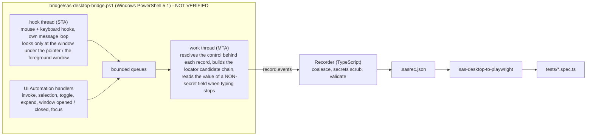

# Record and play: from what a person does to a test

> **NOT VERIFIED.** The recorder (the part of `bridge/sas-desktop-bridge.ps1` that listens to the mouse, the keyboard and Windows UI Automation) was written on a machine with
> no Windows, no PowerShell and no SAS. It has **never run** against a real desktop or the real programs. Everything on the TypeScript side - tidying events into a recording,
> the file format, the converters, the generated tests - is tested against the built-in stand-in desktop, which can *simulate a person at the keyboard*; the PowerShell file
> itself is checked only statically (what it may and may not do, the vocabulary it shares with TypeScript). The first recordings on a real machine are the conformance run:
> start with `npm run doctor`, record something small in Enterprise Guide, then in Management Console, and read [What is assumed about Windows](#what-is-assumed-about-windows-and-the-real-programs-all-not-verified).

Users want what the UI and SAP repos already have: *do it once by hand, get a test*. This repo gives you three ways, in this order of preference
([ADR 0002](adr/0002-record-and-play-for-sas-desktop-apps.md)):

| # | Way | Command | What goes in | What comes out | Status |
|---|---|---|---|---|---|
| 1 | **Record, convert, run** | `sas-desktop-record`, then `sas-desktop-to-playwright` | what you do in SAS Enterprise Guide or SAS Management Console | `<name>.sasrec.json` (data), then a Playwright test with `CONSTANTS` and `LOCATORS` at the top | implemented, tested on the stand-in, **NOT VERIFIED on Windows** |
| 2 | **Import a schedule script** | `sas-eg-import-script` | the script *File > Schedule Project* writes (VBScript, or the PowerShell equivalent) | a test that does the same through the Enterprise Guide COM driver | implemented, **the script's shape is assumed** |
| 3 | **Protocol-level capture** for Management Console administration | (not yet) | what the metadata server logged while an administrator worked | replayable metadata calls | **PLANNED, NOT IMPLEMENTED** - see [Workflow 3](#workflow-3-protocol-level-capture-planned-not-implemented) |

The order of preference of the whole repo still holds: anything a command line or COM can do is done that way. Record the *screens* only for tests **about the screens**; for "run this
project and check the result" import the schedule script (way 2) or write the COM test by hand ([`docs/DESKTOP_SAS.md`](DESKTOP_SAS.md)).

## Before you start

* A Windows machine with an unlocked, connected desktop, the program started **by you, as the same user and with the same elevation as the recorder** (a recorder that is not elevated cannot
  see a program started "as administrator"). `npm run doctor` checks this and everything else ([`DESKTOP_SAS.md`](DESKTOP_SAS.md)).
* **Management Console** is a Java Swing program: Windows UI Automation sees it only with the Java Access Bridge enabled (`jabswitch -enable`, then restart the console). Without it the
  recorder sees a window with no controls and a recording is empty.
* The recorder only runs against an environment you declared in `SAS_ENVIRONMENTS_FILE` (default `env/sas-environments.json`), and production needs `SAS_ALLOW_PROD_READS=true` - the same
  rule every other read follows ([`SECURITY.md`](SECURITY.md)). The run is written to the audit log (`operation: record`, `kind: read`). Set `ENV` / `SAS_ENVIRONMENT` as for any run.
* Build once: `npm run build` (the bridge script's hash is regenerated first).

## Workflow 1: record, convert, run

### 1. Record

Start the program, get it to the screen where your steps begin (a recording that includes the logon starts at the logon dialog), then:

```powershell
# inside this repo (after npm run build)
node dist/recorder/cli/record.js --app eg --out recordings/run_project.sasrec.json
npm run record -- --app eg --out recordings/run_project.sasrec.json         # the same through npm (note the --)

# from a project that depends on this package
npx sas-desktop-record --app eg --out recordings/run_project.sasrec.json
```

`--app` is `smc` (SAS Management Console), `eg` (SAS Enterprise Guide), or a regular expression for the title of a window of another Java or WPF program. Work in the program as you normally
would. Stop with **Ctrl+Alt+Q** (any window: you can press it while another program has the focus; it is recorded in none) or **Ctrl+C** in the terminal. While it runs the terminal shows a live
counter (`events seen: 41`). When it stops it writes the file, prints a summary and a reminder:

```text
Recorded recordings/run_project.sasrec.json: 12 event(s) from 46 raw event(s) in 38.2 s (4 click, 3 text, 1 key, 2 select, 1 dialogHandled)
  windows seen: "SAS Enterprise Guide", "SAS Logon", "Open"
  passwords: nothing typed into a password field was kept - 1 entry(ies) are marked secret (no value); 8 key press(es) in such fields were thrown away
  The converted test reads each secret from the environment (SAS_PASSWORD, SAS_PIN, ...): set them in .env.<env>.local, never in a file you commit.
```

| Option | What it does |
|---|---|
| `--app <smc\|eg\|regex>` | The program to record. Required. |
| `--out <file>` | Where to write (must end in `.sasrec.json`). Default `<SAS_RECORDER_DIR>/<app>-<time>.sasrec.json`. An existing file is not overwritten unless `--force`. |
| `--stop-key <chord>` | The chord that ends the recording (default `Ctrl+Alt+Q`; `SAS_RECORDER_STOP_KEY`). |
| `--mode full\|uia` | `full` = mouse and keyboard hooks plus UI Automation events (default). `uia` = UI Automation events only - no hooks, for a machine where hooks are not allowed; clicks on controls that raise no event and keyboard shortcuts are then missed (`SAS_RECORDER_MODE`). |
| `--secret-pattern <regex>` | Also treat a field whose name or automation id matches as a secret (repeatable; `SAS_RECORDER_SECRET_PATTERNS`). Use it when a password field is not recognised. |
| `--poll-ms <n>` | How often events are collected from the bridge (`SAS_RECORDER_POLL_MS`). |
| `--force` | Overwrite the output file. |
| `--simulator --simulate <actions.json>` | Use the built-in stand-in desktop and let its simulated user perform the actions in the file: for trying the tools on any OS - see [Trying it without Windows](#trying-it-without-windows). |

What the recorder will **not** do: record a window of another program (clicks are looked at only when the window under the pointer belongs to the chosen program; keys only when the
foreground window does), record anything before you start it or after it stopped, record with no program chosen, keep what you type in a password field, keep any character you type
(see [Passwords](#passwords-and-other-secrets)).

### 2. Convert

```powershell
node dist/recorder/cli/convert.js recordings/run_project.sasrec.json --expect-text "NOTE: PROCEDURE" --out tests/desktop-generated
npm run record:convert -- recordings/run_project.sasrec.json --expect-text "NOTE: PROCEDURE"

npx sas-desktop-to-playwright recordings/run_project.sasrec.json --expect-text "NOTE: PROCEDURE"       # from a dependent project
```

The result is tests/desktop-generated/run_project.spec.ts. Every option:

| Option | What it does |
|---|---|
| `<file.sasrec.json \| folder>` | One recording, or every `.sasrec.json` in a folder. |
| `--out <file.ts\|folder>` | A `.ts` file name, or a folder (created). Default `tests/desktop-generated`. |
| `--test-import <module>` | Where `desktopTest` (imported as `test`) and `desktopExpect` (as `expect`) come from. Default `@automation/referenced-automation-sas`; give a relative path to your own base test. |
| `--desktop-import <module>` | A module that exports `DesktopApp`, `DesktopLocator`, `WindowLocator` by those names (for example `../../src/desktop`). Default: taken from the `desktop` namespace of the package root. |
| `--tag <tag>` | Added to the test title (default `@sas-desktop`). |
| `--name <text>` | Base name of the test title, the pages file and the data file (default: the recording's file name). One recording only. |
| `--inline` | Write locators and values where they are used. By default the test starts with `CONSTANTS` and `LOCATORS`. Ignored with `--page-objects`. |
| `--page-objects` | One class per window or dialog in `<out>/pages/<Name>Pages.ts` (with `CONSTANTS` and `LOCATORS` at its top), and a test that uses them. |
| `--data` | Every typed literal becomes a column of `<name>.data.csv`; one test runs per row (the first row holds what was recorded). Works with and without `--page-objects`; not with `--inline`. |
| `--expect-text <text>` | At the end this text must be on the screen, in the main window: `await expect(LOCATORS.mainWindow(app).getByText(CONSTANTS.expected.x).first()).toExist()`. Repeatable. |
| `--expect-window <regex>` | At the end a window whose title matches must be open. |
| `--fixture auto\|app\|loggedOn` | `app`: `smcApp` / `egApp` - the program launched, **not** logged on. `loggedOn`: `smcLoggedOn` / `egLoggedOn`. `auto` (default): `app` when the recording contains the logon dialog or a password was typed, `loggedOn` when it does not. |
| `--allow-no-assertion` | Leave the failing guard out (see below). For examples and spikes. |
| `--no-line-comments` | No `// event N` trace comments. |
| `--strict` | Exit 1 when something needs a human: a `TODO(manual, event N)` step, a control the recording knows only by a screen position, an ambiguous locator, no `--expect-text` / `--expect-window` option. Notes about what the converter did on purpose (a secret replaced by an environment read) do not count. |

**No assertion, no pass.** A recording only performs steps, so a converted test would pass whenever nothing throws. Without `--expect-text` / `--expect-window` the file ends with
`// TODO(converter): no assertion ...`, a header note and `throw new Error('add an assertion: ...')`: the test **fails** until you replace it with a check of the business result.
`--strict` also fails when no assertion option was given, even with `--allow-no-assertion`.

### 3. Review what was generated

A generated test starts like the SAP and UI ones:

```ts
import { desktopTest as test, desktopExpect as expect } from '@automation/referenced-automation-sas';
...
const CONSTANTS = {
  inputs: {
    get userIdField()  { return env.get('SAS_USER'); },        // read from the environment, never the recorded value
    get passwordField() { return env.get('SAS_PASSWORD'); },
    fileNameField: 'C:\\Projects\\Sales.egp',                   // typed values, named after their control
  },
  dialogs:  { tipOfTheDay: { title: /^Tip of the Day$/i, button: 'Close' } },
  expected: { procedureMeansText: 'PROCEDURE MEANS' },
};

const LOCATORS = {                                               // every window and control, named once
  mainWindow: (app: DesktopApp): WindowLocator => app.window(/^(.+ - )?SAS Enterprise Guide$/i),
  runButton:  (app: DesktopApp): DesktopLocator => LOCATORS.mainWindow(app).getByAutomationId('RunButton').orElse(LOCATORS.mainWindow(app).getByRole('Button', { name: 'Run' })),
  ...
};

test.describe.configure({ retries: 0 });                         // only when the recording logs on: a rejected password is never sent twice
test('recorded: run_project @sas-desktop', async ({ egApp: app }) => {
  app.onDialog(CONSTANTS.dialogs.tipOfTheDay.title, (dialog) => dialog.getByRole('Button', { name: CONSTANTS.dialogs.tipOfTheDay.button }).click(), { name: 'tipOfTheDay' });
  await LOCATORS.connectButton(app).click();                     // event 3
  await LOCATORS.userIdField(app).fill(CONSTANTS.inputs.userIdField);   // event 9
  await LOCATORS.passwordField(app).fill(CONSTANTS.inputs.passwordField, { secret: true });   // event 10
  ...
  await expect(LOCATORS.mainWindow(app).getByText(CONSTANTS.expected.procedureMeansText).first()).toExist();
});
```

**The header comment lists what to review.** Read it first: what the test reads from the environment, which session fixture it asks for and why, every event the converter had a remark about
(`event 9: the user ID is read from SAS_USER ...`), and the `TODO(manual, event N)` items. Then:

1. **Every `TODO(manual, event N)`.** The recording only has a screen position (or an ambiguous control) for that event. Find the control with `npm run inspect -- --app eg` (prints every control with a ready-to-paste locator) and write the step. `event N` is the 1-based index in the `.sasrec.json` file.
2. **Weak locators.** Header notes saying *found by class and position only* mean the control has no name or automation id (common in Management Console): the test breaks when the screen gains or loses a control of that kind. Fix the entry in `LOCATORS`, or live with it knowingly.
3. **Names.** `okButton`, `sasLogonOkButton`, `MainPage` are mechanical. Rename them to business terms - they are in one place.
4. **Values.** A typed value that should be unique per run (a user name, a project name) belongs inside the run's namespace (`AUTO_<runId>_...`; see [`SECURITY.md`](SECURITY.md)): the safety policy refuses a mutating step on anything else. Put `vars`/`runContext.ns(...)` in `CONSTANTS`.
5. **The assertion.** `--expect-text` proves one thing is on the screen. Is that the business result? Add more.
6. **Waits.** There are none and none are needed: every step waits for its control and for the program to go idle. Do not add sleeps.
7. **Menus and popups.** A `menu` step looks for `MenuItem`s inside the window. A menu that UI Automation shows as a window of its own may need its locator moved (the converter says so in the header).
8. **Run it on the real program once**, with evidence on (`SAS_EVIDENCE=on`), and look.

Then run it like any test (forward slashes in the path, on Windows too):

```powershell
npx playwright test tests/desktop-generated/run_project.spec.ts --workers=1
```

### Trying it without Windows

The stand-in desktop has a fake Management Console and a fake Enterprise Guide and can *simulate a person*: `--simulator --simulate actions.json` starts the fake program, records, performs the
actions as a user would (the same raw events the real recorder reports) and stops.

```powershell
node dist/recorder/cli/record.js --app eg --simulator --simulate recordings/eg-actions.json --out recordings/eg_sim.sasrec.json
```

`actions.json` is an array of actions; a window is a case-insensitive regular expression for its title; `find` is a control name or UI Automation criteria (`{ "automationId": "RunButton" }`,
`{ "name": "OK", "controlType": "Button" }`; add `"nth": 1` to choose among several):

```json
[
  { "do": "click",  "window": "^SAS Enterprise Guide$", "find": { "automationId": "ConnectButton" } },
  { "do": "select", "window": "^Select Profile$",       "find": "Dev SAS Server" },
  { "do": "type",   "window": "^SAS Logon$",            "find": { "automationId": "userIdField" }, "text": "sasdemo" },
  { "do": "key",    "window": "SAS Enterprise Guide$",  "keys": "Ctrl+O" },
  { "do": "toggle", "window": "Demo", "find": "Remember me", "state": true },
  { "do": "pause",  "ms": 1000 }
]
```

`do` is one of `click`, `doubleClick`, `rightClick`, `type` (with `text`, optionally `"commit": "enter" | "tab"`), `key`, `select`, `toggle`, `expand`, `collapse`, `pause`. In code:
`fake.desktop.simulateUserActions(actions, { virtualTime: true })` (a virtual clock makes recordings identical every time - how the committed examples are made). This proves the tools, **not** that the real programs
look like the stand-in.

The committed examples are [`examples/smc_create_user.sasrec.json`](../examples/smc_create_user.sasrec.json) (choose a profile, log on, open the User Manager, create a user) and
[`examples/eg_run_project.sasrec.json`](../examples/eg_run_project.sasrec.json) (dismiss a tip, connect and log on, open a project with Ctrl+O, run a program), the tests converted from them are in
[`tests/desktop-generated`](../tests/desktop-generated) (flat, page objects, data-driven), and a drift test (`tests/recorder/examples.spec.ts`) fails when either the recorder or the converter changes what
they produce. They were made on the stand-in with two extras only tests have (`tests/recorder/support/extras.ts`: a "New User..." dialog and a "Tip of the Day" dialog). To rewrite them after a deliberate
change: `$env:SAS_UPDATE_EXAMPLES = "1"; npx playwright test tests/recorder/examples.spec.ts --workers=1; Remove-Item Env:SAS_UPDATE_EXAMPLES`.

## What a recording is

A `.sasrec.json` file is **data, not code**, versioned (`"version": 1`; a tool refuses a version it does not know), plain JSON a reviewer can read and the repository's secret scanner can check:

```json
{
  "version": 1, "app": "eg", "startedAt": "2026-10-23T09:00:00.000Z", "tool": "sas-desktop-record 1",
  "events": [
    { "type": "click", "t": 1320, "target": { "window": { "titlePattern": "^SAS Enterprise Guide$" }, "path": [ { "controlType": "Button", "name": "Connect", "automationId": "ConnectButton" } ], "unique": { "automationId": true, "nameAndType": true }, "bounds": { "x": 12, "y": 40, "width": 90, "height": 24 }, "fallbackPoint": { "x": 57, "y": 52 } } },
    { "type": "text",  "t": 4210, "target": { "...": "..." }, "secret": true, "secretKind": "password", "committedBy": "enter" }
  ],
  "stats": { "rawEvents": 46, "secretEntries": 1, "secretKeysDiscarded": 8, "dropped": 0, "durationMs": 38200 }
}
```

| Event | Properties | Meaning |
|---|---|---|
| `windowOpened`, `windowClosed`, `windowActivated` | `title`, `className`, `process`, `owned` | What the program showed. `owned` = a dialog of another window. |
| `click`, `doubleClick`, `rightClick` | `target` | The control the pointer was on. |
| `text` | `target`, `value` **or** `secret: true` (+ `secretKind`), `committedBy`: `enter` \| `tab` \| `blur` | What a field held when typing stopped. **A secret field has no value.** |
| `key` | `keys` (`Ctrl+S`, `Alt+F`, `Enter`, `Escape`, `F5`), `window`, `target?` | A shortcut or a named key - **never a character**. |
| `select` | `target` (the list / tree / tab strip / table), `items` | What was selected in it, by name. |
| `toggle` | `target`, `state` | A check box or toggle button, and the state it was left in. |
| `expand`, `collapse` | `target` | A tree node. |
| `menu` | `window`, `path` (`["File", "Open"]`) | A path through a menu. |
| `dialogHandled` | `title`, `button` | A dialog that only needed one button pressed (a prompt, a tip): the converter registers a handler for it. |

Every `target` is a **locator candidate chain**: the window (`titlePattern` is an anchored, escaped regular expression of its title), then the path from the window down to the control with what UI Automation
reported for each element (`controlType`, `name`, `automationId`, `className`, and an `index` - the position among controls of that type and class in the window - only for an element that has neither a name nor an id),
the control's `bounds` and the pointer's `fallbackPoint` (relative to the window), and whether the recorder found the id / the name unique in the window (`unique`). The converter chooses among the candidates.
`validateRecording()` (and `RECORDING_JSON_SCHEMA`, for editors) check a file; every writer and the converter run it first.

### How raw events become a recording

The bridge reports *raw* events (one per thing UI Automation or the hooks saw); the TypeScript recorder tidies them (`src/recorder/coalesce.ts`): consecutive typing in one field becomes one `text` at its commit
(Enter, Tab, or leaving the field); a click followed by the invoke it raised is one click; two quick clicks on one control are a `doubleClick`; a click followed by a toggle, a selection or an expansion on that control is a
`toggle`, `select`, `expand`; a burst of selections in one list is one `select` (several items only when they were *added* to the selection); clicks through a menu are one `menu`; a click that only focused a field you then
typed into is dropped; a dialog that opened, had one button pressed and closed is a `dialogHandled`. Malformed events are dropped and counted, never thrown at.

## Passwords and other secrets

A recording **never contains a secret**, and a generated test never contains one either. This is enforced at every layer, each tested:

1. **In the bridge** (`bridge/sas-desktop-bridge.ps1`). A field is *secret* when UI Automation says `IsPassword`, or its name, automation id, help text or label contains one of the words *password, pwd, pw, pass, passwd, passcode, passphrase,
   credential(s), pin, otp, token, secret, key* (judged by whole words, so a "spinner" is not a PIN), or it matches a pattern you gave (`--secret-pattern`). While such a field has the focus every key press is **thrown away inside the
   keyboard hook** (counted, never queued with its key code); only Enter, Tab and Escape get through, because they carry no content. The field's value is **never read**. If the bridge cannot tell, it treats the field as secret.
   And **no characters are ever taken from key presses at all**: the hook queues key codes only; what a field held is read from the field (UI Automation `ValuePattern`) when you stop typing - never for a secret field.
2. **In the recorder** (`coalesce.ts`). A `typed` event for a secret field loses whatever value came with it; a field named like a secret is a secret entry even if the bridge did not flag it; a key press that would type a character
   is dropped; a key aimed at a secret field is dropped unless it is Enter, Tab or Escape.
3. **In the file.** `validateRecording` refuses a `secret: true` entry that has a `value`, and a field named like a secret that has one. `serializeRecording` and `sas-desktop-record` run it before writing, so a leak cannot reach a file
   through them. `tests/recorder` scans the committed recordings and generated tests with the repository's secret rules.
4. **In the converter.** A secret entry becomes an environment read by kind of field - password `SAS_PASSWORD`, PIN `SAS_PIN`, one-time code `SAS_OTP`, token `SAS_TOKEN`, secret `SAS_SECRET`, key `SAS_API_KEY` -
   written as a getter in `CONSTANTS`, typed with `fill(..., { secret: true })` (never logged, never read back). The **user ID** in a logon window is read from `SAS_USER` and the **connection profile** from `SAS_SMC_PROFILE` /
   `SAS_EG_PROFILE`: a profile name identifies a server and is not stored either. Settings: `.env.example`, section "RECORDER" (the secrets go in `.env.<ENV>.local` or a masked CI variable).
5. **A recording that logs on runs the logon once and switches retries off** (`test.describe.configure({ retries: 0 })`): Playwright's retries would send a rejected password again and can lock the account. `LogonRejected` is never retried.

**What you must still check.** The bridge can only recognise a secret by what UI Automation shows. A Management Console (Swing) password field is recognised when the Java Access Bridge reports it as a protected text field
(`IsPassword`) or its accessible name says so; if a field is neither, **its value would be recorded**. After the first recording in Management Console, open the file and search for what you typed; add `--secret-pattern`
for any field it missed. Nothing typed in a field that is not a secret is hidden: do not type real personal data while recording.

## How the converter chooses a locator

Best first (`src/recorder/locators.ts`):

| Rung | Locator | Used when |
|---|---|---|
| 1 | `AutomationId` - `.getByAutomationId('RunButton')` | the id is not generated (not a GUID, no run of 5+ digits) and the recorder did not see it twice in the window |
| 2 | `Name` + control type - `.getByRole('Button', { name: 'Run' })` | the name is not data (a time, a long number) and was not seen twice |
| 3 | `ClassName` + position - `.locator({ controlType: 'Edit', className: 'JTextField' }).nth(2)` | nothing better exists (typical for Swing). Listed in the header as a weak locator. |
| - | a screen position only | **`TODO(manual, event N)`** - and `--strict` exits 1 |

When two of rungs 1-2 exist the second follows as `.orElse(...)`: the framework uses it when the first no longer matches and reports a LOCATOR DRIFT warning (`session.driftItems`) - never silent healing. A positional locator is
**never** added as a fallback behind a better one: a wrong control found by position is worse than a clear failure. When the recorder saw that the id or name is not unique in the window, the locator is narrowed by the nearest
named ancestor (`window.getByRole('Pane', { name: 'Details' }).getByRole('Button', { name: 'OK' })`); with nothing to narrow by it is listed as a TODO.

Other conversions: modal dialogs that only needed a button become `app.onDialog(...)` handlers registered at the top of the test (they run before any step that finds the dialog in front); keys become `press(...)` in SendKeys
syntax (`Ctrl+S` -> `^s`, `Alt+F4` -> `%{F4}`, `Enter` -> `{ENTER}`; shortcuts go to the window, named keys to the control that had the focus); windows whose titles differ only by a document name in front of the product
name (`Sales - SAS Enterprise Guide`) are one window (`^(.+ - )?SAS Enterprise Guide$`); no sleep is ever written.

## Management Console and Enterprise Guide are not the same

| | Enterprise Guide (WPF) | Management Console (Java Swing) |
|---|---|---|
| What UI Automation sees | many controls with `AutomationId`s and names | names and roles **only after the Java Access Bridge is enabled**; almost never an `AutomationId` |
| Locators in a recording | mostly rung 1 with rung 2 as fallback | mostly rung 2, often rung 3 (class and position), some `TODO(manual)` |
| Typical header notes | profile and logon variables | *found by class and position only*, a menu that may be a popup window |
| Secret fields | `IsPassword` is reliable | depends on the Java Access Bridge; **check the file** (see above) and use `--secret-pattern` |
| Where it is worth it | the screens of Enterprise Guide itself | a handful of screens; administration belongs to the batch tools and metadata calls (`src/process`), or to Workflow 3 |

Expect to review every Management Console recording more closely than an Enterprise Guide one, and to keep those tests few.

## Workflow 2: import a schedule script

*File > Schedule Project* in Enterprise Guide writes a script that opens a project, runs it, optionally saves and quits, through the **automation object model**. This turns it into a test that does the same through
`SasEnterpriseGuide` (COM, no window clicked):

```powershell
node dist/recorder/cli/importScript.js scripts/Sales.vbs --out tests/desktop-generated --strict
npm run record:import-script -- scripts/Sales.vbs
npx sas-eg-import-script scripts/Sales.vbs                    # from a dependent project
```

**ASSUMED, not checked against a script written by an installed Enterprise Guide** (from SAS's documentation and community write-ups of running Enterprise Guide projects in batch; version numbers differ):

```vbscript
Set app = CreateObject("SASEGObjectModel.Application.7.1")        ' the version is that of the installed Enterprise Guide
app.SetActiveProfile("My Server")                                  ' optional
Set prj = app.Open("C:\Projects\Sales.egp", "")
prj.Run
prj.Save
prj.Close
app.Quit
```

| Script | Test |
|---|---|
| `CreateObject("SASEGObjectModel.Application.x.y")` / `New-Object -ComObject ...` | `SasEnterpriseGuide.connect(desktopSession, { progId })`; the version is the default of `SAS_EG_PROGID` |
| `app.SetActiveProfile("name")` | `profile` read from `SAS_EG_PROFILE` (the name is **not** written into the test) |
| `Open("path", "")` | `eg.openProject(CONSTANTS.project)` |
| `prj.Run` | `eg.runProject()` - then the test asserts that **no program ended with an error** (`--fail-on-warnings`: or a warning) |
| `prj.ContainerCollection.Item("Process Flow 1").Run` | `eg.runProcessFlow(...)`, then the program statuses (by **name**; an index is a TODO) |
| `prj.Save`, `prj.Close` | `eg.saveProject()`, `eg.closeProject()` |
| `app.Quit` | covered by `eg.quit()` in a `finally` block, so a failed run still closes Enterprise Guide |
| variables holding text, `&` / `+` joins, comments, line continuations, `:` / `;` separators, UTF-16 files | followed |
| a variable named like a secret (`password = "..."`) | its literal is dropped; copied source lines have their string literals redacted |

Everything else - another object, `On Error Resume Next`, `SaveAs`, any `If`/`For`/`Do`/`Try` block and everything inside it (a step inside an `If` would otherwise run unconditionally) - becomes
`TODO(manual, script line N)` with the reason and fails `--strict`. A script that runs nothing has nothing to assert: the same failing guard as for recordings.
The test needs the `desktopSession` fixture (`--session-fixture` renames it). Which members of the object model exist in *your* version is the table `EG_COM` in `src/desktop/apps/enterpriseGuide.ts` - the one place to fix.

## Workflow 3: protocol-level capture (PLANNED, NOT IMPLEMENTED)

**Nothing in this section exists yet.** It is what [ADR 0002](adr/0002-record-and-play-for-sas-desktop-apps.md) plans for *administration* in Management Console, where clicking through Swing screens is the most fragile way to
automate "create this user and put it in that group": record **what the administrator changed** instead of how the screens looked.

The idea: with the metadata server's loggers raised, the server writes down what the console asks it to do. `App.OMI` set to TRACE records the XML requests (limited by the line limits `JNLLINEMAX` / `JNLSTRMAX`); the audit
loggers (`Audit.Meta.Updates`, `Audit.Meta.Security.*`) record who added, updated and deleted which object, and changes to users, groups, ACTs and permissions. A future command (`sas-metadata-capture start|stop`) would read the server
log slice for the session, extract the metadata requests and turn them into replayable calls in a `MetadataAdmin` layer (SAS code or batch-tool commands), with the audit entries as the expected-outcome check.

What it needs, honestly: **a server administrator** has to raise those loggers - on a **non-production** environment, and reset them afterwards (trace logging is verbose and can contain personal data); the captured text is limited
by the line limits; the logs are processed in memory and only the derived calls are written, never the log. It would be refused for production and off by default. None of the commands, files or settings it implies exist,
and `MetadataAdmin` is not written. Until then: administration is done by `src/process` (batch tools and metadata calls as SAS code); the screens are recorded only for tests about the screens.

## How the recorder works



* **Three operations** extend the bridge protocol: `record.start { pid | processName | titleRegex, mode, maxQueue, secretPatterns, stopKey }` (refuses without a target; refuses when no window of that program is open),
  `record.events { drain }`, `record.stop`. The bridge script compiles the recorder's C# **on first use** (not at start-up), so a bridge that never records pays nothing and a compile problem in this unverified part can
  not stop the rest of the bridge: `record.*` then answers `NOT_IMPLEMENTED` with the compiler's message.
* **The hooks** sit on a dedicated STA thread with its own message loop; the hook procedures only look at which program a window belongs to and queue a small record (no UI Automation, no waiting); they always pass the event on;
  the hooks are removed in a `finally` block, and the bridge stops the recorder when it ends. The queue and the event list are bounded (`SAS_RECORDER_MAX_QUEUE`); what does not fit is dropped and counted.
* **Injected input** (what other tools send) is ignored. The stop chord is the one thing noticed in any window.
* **Static checks** (`tests/recorder/bridgeRecorder.spec.ts`) read the script and fail if any of those properties is lost; the stand-in implements the same three operations with the same rules and is what the TypeScript side is tested against.

### What is assumed about Windows and the real programs (all NOT VERIFIED)

* A C# 5 compatible compile of the recorder source in Windows PowerShell 5.1, and that `SetWindowsHookEx` with `WH_MOUSE_LL` / `WH_KEYBOARD_LL` works from a PowerShell process on an STA thread with a message loop,
  without elevation, for a program of the same user and elevation. Low-level hooks must return quickly (Windows removes a hook that does not): ours queue and return.
* `AutomationElement.FromPoint` returns the control under the pointer fast enough, **at mouse-down, before the click changes the screen** (the work thread resolves it from the queued record; a human click lasts longer).
* UI Automation raises `InvokePattern.Invoked`, `SelectionItemPattern.ElementSelected` / `ElementAddedToSelection`, toggle and expand-collapse property changes, `WindowPattern.WindowOpened` / `WindowClosed` and focus changes for
  WPF **and** (through the Java Access Bridge) for Swing controls. A Swing control that raises no event is recorded only by its click.
* `ValuePattern` is available on the text fields whose value is wanted; where it is not, the typed value cannot be read and **nothing is recorded** for that field (no event, not a guess).
* A dialog shows up in UI Automation as a window owned by the main window (a child element) or as a top-level window; both are handled. A menu popup may be a window of its own.
* A Swing password field is reported with `IsPassword` (the Java Access Bridge maps a protected text field) or has an accessible name that says so.
* The `Name`, `AutomationId` and class names listed in a recording are what the real program reports; the stand-in's names are written independently of the application layers' tables and prove nothing about the real ones.
* For Enterprise Guide's schedule script: the shape shown above and the member names of `EG_COM`.

## Troubleshooting

| Symptom | Likely cause | What to do |
|---|---|---|
| `record.start: no window of the chosen program is open - start the program first` | The program is not running in this desktop session, or `--app` does not match its window title | `npm run inspect:windows` lists the windows; give `--app` a regular expression that matches one |
| `this bridge cannot record: ... is not available in this bridge` | An old bridge, or the recorder's C# did not compile on this machine (the message says why) | Use the bridge this version ships; `npm run doctor`; send the compiler message |
| `could not install the mouse and keyboard hooks` | Hooks blocked by policy or security software, or the program runs with higher rights | Run the bridge with the same elevation as the program, or record with `--mode uia` |
| The recording is empty or has only window events | Management Console without the Java Access Bridge (the window looks empty to UI Automation) | `jabswitch -enable`, restart the console, `npm run inspect -- --app smc` must show controls |
| `event(s) were lost because the bridge's queue was full` | A burst of events and a slow collection | Raise `SAS_RECORDER_MAX_QUEUE` or lower `SAS_RECORDER_POLL_MS` |
| The test says `TODO(manual, event N)` | The control had no name, id or class to find it by | Find it with `npm run inspect`, write the step |
| `... is ambiguous: 2 controls match` when the test runs | A name or id is not unique and nothing narrowed it | Chain from a container in `LOCATORS`, or `.nth(i)` |
| A value you typed in a password field shows up in the file | The field was not recognised as secret | Delete the file, record again with `--secret-pattern "<its name>"`; report the field name |
| `... looks like a password field ... but a value was recorded` | A file edited by hand, or from another tool | Write `secret: true` and remove the value (the converter refuses the file until you do) |
| `this tool reads version 1 (the file is version N)` | A recording from a newer tool | Convert it with a tool of that version |
| `environment "x" is not declared` / `production ... reads there are switched off` | The recorder's environment gate | Declare the environment in `SAS_ENVIRONMENTS_FILE`; production needs `SAS_ALLOW_PROD_READS=true` |
| The converted test fails at the logon with `LogonRejected` | `SAS_PASSWORD` (or `SAS_USER`, the profile variable) is wrong or missing | Fix `.env.<ENV>.local`. It is **not** retried; the logon guard's cooldown applies |
| The converted test passes but proves nothing | Only `--expect-text` for something that was always there | Assert the business result |
| `the recording is of "x", a program the framework has no fixture for` | `--app` was a window title, not `smc` / `eg` | Provide `xApp` / `xLoggedOn` fixtures in your own base test and pass `--test-import` |
| `sas-eg-import-script` makes only TODOs | The script is not the schedule script's shape (control flow, other objects) | Convert by hand; the shape it expects is above |

## Reference

* **Commands** (add these `bin` entries and scripts to `package.json`; the paths are the build output):

  | Command | File | npm script |
  |---|---|---|
  | `sas-desktop-record` | `dist/recorder/cli/record.js` | `record` |
  | `sas-desktop-to-playwright` | `dist/recorder/cli/convert.js` | `record:convert` |
  | `sas-eg-import-script` | `dist/recorder/cli/importScript.js` | `record:import-script` |

* **Settings**: `.env.example`, section "RECORDER" (`SAS_RECORDER_DIR`, `SAS_RECORDER_STOP_KEY`, `SAS_RECORDER_MODE`, `SAS_RECORDER_POLL_MS`, `SAS_RECORDER_MAX_QUEUE`, `SAS_RECORDER_SECRET_PATTERNS`, and `SAS_PIN`, `SAS_OTP`, `SAS_TOKEN`,
  `SAS_SECRET`, `SAS_API_KEY` that converted tests read). Read only through the shared config (`src/recorder/config.ts`).
* **Code** (`src/recorder`, exported as `recorder` from the package root): `Recorder` (`start`, `collect`, `stop`, `preview`, `save`, `eventsSeen`, `stopRequested`), `coalesce`, `validateRecording` / `parseRecording` /
  `serializeRecording` / `RECORDING_JSON_SCHEMA`, `convertRecording`, `importEgScript`, `planLocator`, `authorizeRecording`, `summarizeRecording`, `recorderConfig`. The protocol types (`RawEvent`, `Target`, `UserAction`) are in
  `src/desktop/recording.ts`; the stand-in's recorder and `simulateUserActions` in `src/desktop/fakeDesktop.ts`.
* **Tests**: `tests/recorder` (format, secrets, coalescing, the stand-in recorder, the recorder, the converter, locators, generated tests run and type-checked, the schedule-script importer, the three commands, the bridge's recorder
  source, the settings) and `tests/desktop-generated` (the committed examples, which run under the normal runner).
