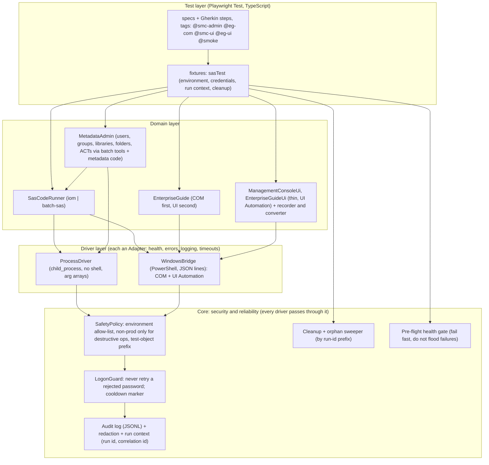

# 0001. SAS desktop automation: command-line and COM drivers behind a policy gate, a Windows UI Automation layer, all in TypeScript on Playwright Test

- **Status:** Proposed (decision requested; see "What is not decided")
- **Date:** 2026-10-23
- **Approved by:** _not yet recorded_
- **Context document:** [`../AUTOMATION_APPROACHES.md`](../AUTOMATION_APPROACHES.md) lists every option considered.

## Scope
**SAS Viya is out of scope for this repo**: the family's `api` and `ui` packages already automate it with ordinary code. This repo covers the SAS **desktop** programs - SAS Management Console and SAS Enterprise Guide (and, later, other SAS desktop clients such as Data Integration Studio or Enterprise Miner, which are Java programs and use the same layer).

## Context
We must automate SAS Management Console (a Java Swing desktop tool for the SAS 9.4 metadata server) and SAS Enterprise Guide (a WPF desktop client) in an enterprise: tests are written in TypeScript, run by Playwright Test on Node, started from a Windows machine (an AWS WorkSpace) with a **personal** login, against shared SAS environments. The existing family (`utils`, `api`, `ui`, `sap`, `ui-api`) already supplies the runner configuration, the `Adapter` contract, logging with correlation ids, secret masking, an API client with OAuth, page-object conventions, a line-protocol PowerShell bridge pattern (SAP) and a remote-desktop utility.

## Decision
1. **Playwright Test stays the only runner and TypeScript the only test language.** Everything non-browser is reached from Node by one of four mechanisms, each wrapped as an `Adapter` (health check, typed errors, logging, timeouts): **HTTPS** (only where needed; the `api` package), **a child process with an argument array** (SAS command-line tools), **a PowerShell bridge speaking a JSON line protocol** (COM objects and Windows UI Automation), and **the browser** (Playwright). No second test framework, no Python or Java in the core path.
2. **API first, GUI last.** Anything an API, command-line tool or COM object can do is done that way. GUI automation exists only to test the GUI itself. Image/coordinate automation is not used.
3. **A policy gate in front of every privileged action** (see Security). A test cannot create, change or delete SAS objects, or run code, except through a driver that passes the gate.
4. **Capability-based design.** Every driver reports whether it is usable on this machine and environment (`doctor`), and tests declare what they need (`@smc-admin`, `@eg-com`, `@smc-ui`, ...) so a missing capability skips with a reason (and is visible in the report) instead of failing.
5. **One SAS "code runner" abstraction** (`SasCodeRunner`) returning state, log and listing, with interchangeable back ends: an Integration Technologies workspace server (COM through the bridge) and batch `sas.exe`. Tests and the admin layer do not care which one the environment offers.

## Architecture

### Which mechanism for what
| Target | Primary | Secondary (GUI) |
|---|---|---|
| SAS 9.4 metadata administration | Batch tools (`ProcessDriver`) and metadata calls run as SAS code (`SasCodeRunner`) | Management Console GUI (bridge: Java Access Bridge + UI Automation), a handful of screens only |
| Enterprise Guide | Automation object model (COM, bridge) to open and run projects; `SasCodeRunner` to run code | EG GUI (bridge, UI Automation) for EG's own screens |

Java and the SAS Open Metadata Interface client (`com.sas.metadata.remote`) are **not** in the core path: they would add a JVM, version-matched SAS jars and a helper process. They are held in reserve and added only if the installation inventory shows the batch tools and metadata code cannot reach something required.

## Security model (non-negotiable properties)
- **Credentials.** Personal login from `SAS_USER` / `SAS_PASSWORD` in `.env.<env>.local` or the environment, never committed (the secret scanner and `.gitignore` enforce it), never printed, masked in logs, step titles, exchanges, traces' step names, dumps and errors. **No password on a process command line** where a profile file, an encoded value or standard input is possible; where a SAS tool offers only `-password`, the driver uses SAS's encoded form and the docs flag it. A dedicated test account with least privilege is the target state; a personal login is accepted for now and raises the next rule.
- **Lockout protection.** A rejected password is never retried, by the driver or by Playwright's retries. After a rejection the same user+environment+password fingerprint is refused for a cooldown (default 15 minutes) with a clear message. One logon per worker; tokens are cached and shared (single flight).
- **Environment allow-list and safety policy.** Environments are declared (`dev`, `qa`, ...): host patterns, kind (`nonprod` or `prod`). A driver refuses any host not on the list. **Mutating operations are refused unless the environment is `nonprod` and the object is inside the run's test namespace** (`AUTO_<runid>_...` folders, groups, libraries). Production is read-only by construction; reads need an explicit setting.
- **TLS and transport.** Certificate verification on; turning it off needs a named setting with a reason and appears in the report header. Tokens are never written to disk; storage state files are git-ignored and expire.
- **Process and script hygiene.** Child processes use argument arrays (no shell string building, so no injection), a fixed working directory, an environment allow-list, timeouts and process-tree kill. The PowerShell bridge script is shipped in the package, **verified against a pinned SHA-256 before it runs**, and can be run from a signed/approved folder without `-ExecutionPolicy Bypass`.
- **Evidence hygiene.** Screenshots and dumps of admin screens can contain personal data: off by default (`failure` only), masked fields, written under `test-results`, kept for a bounded time.
- **Supply chain.** No new third-party runtime dependencies: the drivers use Node built-ins, the `api`/`ui`/`utils` packages and Windows' own components. Packages come from the organisation's registry by version.
- **Audit.** Every privileged action writes one JSONL record (time, run id, correlation id, driver, environment, operation, target object, outcome; no secrets) that can be handed to security review.

## Reliability model
- **Pre-flight health gate.** Before a suite, each driver's `health()` runs (metadata server port, COM object creation, bridge ping, desktop session interactive). A red gate fails once with the cause instead of hundreds of timeouts.
- **Waiting without sleeps.** Batch tools and code runs wait on the process or job state with deadlines; the desktop bridge waits for the control and for the window's input to go idle (as the SAP session does).
- **Isolation and clean-up.** Each run owns a namespace (`AUTO_<runid>`); created objects are registered for clean-up (newest first, after pass or fail); an orphan sweeper removes leftovers older than a threshold. Tests never depend on each other's data.
- **Determinism for desktop work.** One desktop session = one worker (workers forced to 1 where a single interactive desktop is the resource); modal dialogs are handled by registered handlers, never by sleeping.
- **No silent skips.** A test skipped for a missing capability says why and is counted by the minimum-executed gate.
- **Version resilience.** Every GUI locator lives in one table per application; an `inspect` command prints the live control tree with ready-to-paste locators; conformance suites run each driver against the real system (like the SAP `doctor --conformance`) and gate releases.
- **Honest verification.** Everything is developed against stand-ins (a fake desktop bridge with fake Management Console and Enterprise Guide windows, a fake batch tool); what only a real SAS system can prove is labelled NOT VERIFIED until the conformance suite has passed there.

## Consequences
Faster, more stable tests than GUI-only automation; a small, reviewable surface that security can approve; the GUI layer stays thin and replaceable. Costs: the COM/batch-tool pieces need the installed SAS client software and exact release details (the inventory script supplies them); the policy gate means every new operation must be classified (read, create-in-namespace, destructive); the desktop layer still needs an unlocked interactive session and the Java Access Bridge for Management Console.

## What is not decided (needs your input)
1. Results of `scripts/inventory-sas.ps1` (which batch tools, COM objects and jars exist).
2. Whether Management Console's own screens must be automated, or administrator tasks verified through M1/M2 are enough.
3. The exact product behind "SAS enterprise application" (assumed Enterprise Guide).
4. Whether a dedicated test account / OAuth client can be provided (strongly recommended; a personal login is supported with the protections above).
5. Which environments exist, their hosts, and which are non-production.

## Build order
1. Foundation: environments, credentials, policy gate, logon guard, audit log, run context, health gate, `doctor`; the `ProcessDriver`.
2. `WindowsBridge` (COM + UI Automation) with a fake bridge and the `inspect` command; the Management Console and Enterprise Guide layers (COM first for EG, UI thin).
3. **Record and play** ([ADR 0002](0002-record-and-play-for-sas-desktop-apps.md)): the recorder in the bridge, the converter to Playwright tests, protocol-level capture for Management Console admin work.
4. After the installation inventory: `SasCodeRunner` back ends (workspace server, batch `sas.exe`), the batch-tool wrappers and `MetadataAdmin`.
5. Fixtures, Gherkin steps, examples, configuration reference, CI templates, conformance suites; ADRs and family docs.
